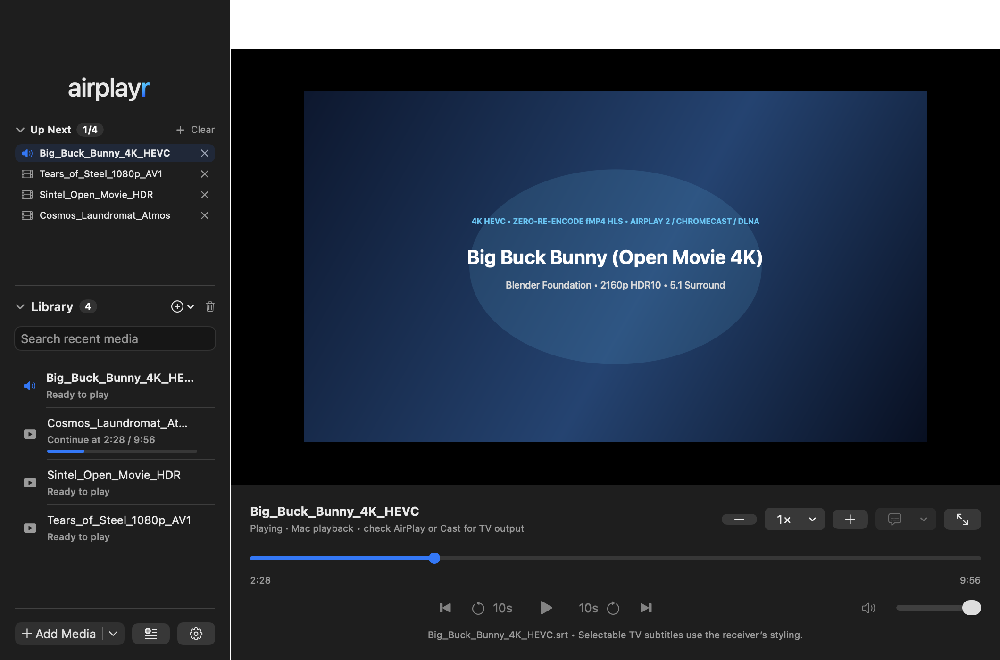

<p align="center">
  
</p>

<h1 align="center">AirPlayr</h1>

<p align="center">
  <strong>Your movies. A bigger screen—100% local on your Wi-Fi, with no internet, login, or telemetry.</strong><br />
  Native media player and wireless streamer for <strong>AirPlay 2</strong>, <strong>Chromecast</strong>, and <strong>Miracast / DLNA</strong> built natively for <strong>macOS</strong> and <strong>iOS / iPadOS</strong>.<br />
  <em>Version 1.6.0 · Universal Binary (Apple Silicon &amp; Intel) · Free &amp; Open Source (MIT)</em>
</p>

<p align="center">
  <a href="#why-airplayr">Why AirPlayr</a> ·
  <a href="#install--quick-start">Install &amp; Quick Start</a> ·
  <a href="#platforms-and-targets">Platforms &amp; Targets</a> ·
  <a href="#how-to-use">How to Use</a> ·
  <a href="#keyboard-shortcuts">Shortcuts</a> ·
  <a href="#media--receiver-compatibility">Compatibility</a> ·
  <a href="CHANGELOG.md">Changelog</a>
</p>

<p align="center">
  
</p>

---

## Why AirPlayr?

Most desktop video players force a trade-off: either they can’t stream MKVs to your TV without installing command-line tools, or they lock basic casting behind paid subscriptions, online activation checks, and unsandboxed background daemons.

**AirPlayr** is built differently:

- **Every TV in your home:** Stream natively to **Apple TV & AirPlay 2 TVs**, **Chromecast** devices, and **Miracast / DLNA** smart TVs with **automatic SSDP multicast discovery**.
- **Zero-Re-Encode 1080p / 4K Passthrough & Instant MKV/AV1/HEVC Streaming:** Compressed H.264/HEVC packets are muxed directly into `fMP4` HLS segments without re-encoding when no pixel burn-in is needed, and hardware `VideoToolbox` encoding preserves up to **4K (`3840×2160`)**. Bundled minimal LGPL FFmpeg 9.0.2 helpers automatically prepare H.264, HEVC, and hardware-decoded AV1 MKVs in **6-second on-demand sections**.
- **100% local & offline-ready:** Runs inside the **macOS App Sandbox** over your local Wi-Fi. No internet connection required, no login, no analytics, no telemetry, and no cloud uploads.
- **Playlists, Up Next Queue & Media Keys:** Open multiple files or entire folders into an **Up Next Queue** with auto-advance, `⌘[` / `⌘]` navigation, **macOS Control Center (`MPNowPlayingInfoCenter`)**, hardware media keys, and AirPods remote control.
- **Rich subtitle & audio track support:** Automatically loads matching `<movie>.srt` files, extracts embedded SRT, **ASS / SSA**, and MP4/MOV timed-text tracks, supports live **Subtitle Sync Offset (`±0.25s`)**, remembers preferred audio/subtitle languages, and includes an **opt-in OpenSubtitles search** using local 64-bit movie hashes.
- **Awake while playing:** Automatically keeps your display awake while your movie is playing or streaming to the TV, and releases the sleep lock as soon as you pause or stop.

| Capability | AirPlayr v1.6 | Commercial Streamers (e.g., AirFlow) | Generic Players (VLC / IINA) |
| --- | --- | --- | --- |
| **AirPlay 2, Chromecast & Auto-SSDP DLNA** | ✓ All three built in | AirPlay + Chromecast only | Partial / unstable |
| **Zero-Re-Encode 1080p / 4K `fMP4` HLS** | ✓ Native passthrough + 4K | ✓ Custom engine | Transcodes or fails |
| **MKV (H.264, HEVC, AV1) & ASS Subtitles** | ✓ 6s on-demand VOD sections | ✓ Supported | Varies |
| **Playlists, Media Keys & Live Sub Sync (`±0.25s`)** | ✓ Built in | ✓ Supported | Varies |
| **Native Apple Targets** | ✓ macOS (Universal) & iOS / iPadOS | macOS / Windows only | Desktop / Mobile |
| **100% Offline (No Login or Telemetry)** | ✓ Full App Sandbox, 0 telemetry | Unsandboxed + online license activation | Unsandboxed |
| **Price & License** | ✓ Free & Open Source ([MIT](LICENSE)) | Paid proprietary license | Free |

---

## Install & Quick Start

### Option 1: Install from DMG (Recommended for Users)

1. Download **`AirPlayr-1.6.0.dmg`** from the latest release (or build it locally with `task dmg`).
2. Open the DMG and drag **AirPlayr** into **Applications**.
3. Launch **AirPlayr**. When streaming to a TV for the first time, click **Allow** when macOS asks for **Local Network** access.

### Option 2: Build & Install from Source

Requires macOS with Xcode and [Task](https://taskfile.dev/) (`brew install go-task`):

```sh
# Build and launch the universal Release app
task run

# Install directly into /Applications (or override INSTALL_DIR)
task install
task install INSTALL_DIR="$HOME/Applications"

# Package a verified drag-to-Applications DMG (build/dist/AirPlayr-1.6.0.dmg)
task dmg
```

### All Developer Tasks

| Command | Purpose |
| --- | --- |
| `task` | List all available tasks |
| `task build` | Build the universal (`arm64` + `x86_64`) Release app |
| `task run` | Build and open the Release app |
| `task test` | Run the full XCTest suite (`xcodebuild test`) |
| `task compat-check` | Verify universal slices & `minOS` for macOS 15, 26, 27 + Public Beta |
| `task verify` | Verify Release code signature and macOS compatibility |
| `task release-check` | Verify Developer ID, Hardened Runtime, App Sandbox, and Gatekeeper |
| `task media-tools` | Rebuild bundled universal LGPL FFmpeg 9.0.2 helpers from pinned source |
| `task project` | Deterministically regenerate `AirPlayr.xcodeproj` |
| `task website` | Preview the marketing site (`index.html` / `website/`) at `http://127.0.0.1:8080` |
| `./scripts/run-cross-platform-tests.sh` | Run macOS XCTest and iOS Simulator test suites |

---

## Platforms and Targets

AirPlayr is focused natively on Apple devices with living-room streaming to all TVs:

- **macOS (`AirPlayr/`):** Flagship universal (`arm64` + `x86_64`) app for Apple Silicon (M1–M5) and Intel Macs running macOS 14+. Full App Sandbox, native AirPlay 2 output, CastV2 TLS port `8009`, UPnP/DLNA auto-SSDP discovery, and IOKit sleep prevention.
- **iOS & iPadOS (`platforms/ios/`):** Native SwiftUI companion target sharing the core Swift streaming engine with `AVRoutePickerView`, Files.app security bookmarks, and mobile background audio.
- **Web Player (`website/web-player.html`):** 100% client-side browser playback using `URL.createObjectURL`, W3C Remote Playback, WebKit AirPlay, and in-browser subtitle sync.
- **Experimental Alpha (`alpha` branch):** Windows, Linux, and Android proof-of-concept builds are maintained on the [`alpha`](https://github.com/sarthak7gupta/AirPlayr/tree/alpha) branch.

---

## How to Use

1. **Open Media:** Press **⌘O**, click **Open Media…**, or drag video/audio files directly into the window. Your recent media is remembered in the sidebar with automatic resume positions.
2. **Play & Seek:** Press **Space** to play or pause. Click or drag anywhere along the timeline to scrub; distant seeks in compatibility streams encode only the target 6-second section on demand.
3. **Stream to AirPlay:** Click the **AirPlay** icon in the toolbar to route audio/video to an Apple TV or AirPlay-compatible Smart TV. If Apple’s direct engine rejects the container or codec, AirPlayr automatically switches to its on-demand HLS compatibility stream at your current playback position.
4. **Stream to Chromecast or Miracast / DLNA:** Click the **Cast (`tv.badge.wifi`)** icon in the toolbar:
   - Choose any discovered **Chromecast** on your local network.
   - Click **Connect to Cast / Miracast by IP…** to add a Chromecast (TLS port `8009`) or Miracast / DLNA `AVTransport` renderer by IP address.
   - Click **Open macOS Wireless Display Settings…** for OS-level hardware Miracast / Wireless Display sinks.
5. **Subtitles & Audio Tracks:** Click the **Captions (`captions.bubble`)** button in the transport bar to switch audio tracks, select embedded or external `.srt` subtitles, customize **Subtitle Display…** (size, width, box/outline, position), or toggle **Burn External SRT into TV Video**.
6. **Playback Speed & Sleep Prevention:** Adjust speed from **0.5× to 4.0×** in `0.25×` steps. Toggle **Prevent Mac from sleeping while a file is playing** in **Settings (`⌘,`)** or the **Playback** menu (enabled by default).
7. **Offline TV Copy (Optional):** Use **Playback → Export TV-Compatible Copy…** to save a standalone 720p/30fps H.264/AAC `.mp4` with burned-in subtitles.

---

## Keyboard Shortcuts

| Key | Action |
| --- | --- |
| `Space` | Play / Pause |
| `←` / `→` | Skip backward / forward (5s, 10s, or 30s — configurable in Settings) |
| `↑` / `↓` | Volume up / down (`5%` steps) |
| `M` | Mute / Unmute |
| `⌘O` | Open media file(s) |
| `⇧⌘S` | Load external `.srt` subtitles |
| `⌘.` | Stop playback and clear player |
| `⌃⌘F` | Enter / Exit Full Screen |
| `Esc` | Exit Full Screen |
| `⌘,` | Open Settings |

---

## Media & Receiver Compatibility

| Container / Format | Local Playback | AirPlay / Cast TV Stream | Notes |
| --- | --- | --- | --- |
| **MP4, M4V, MOV (H.264 / HEVC)** | ✓ Native | ✓ Direct or Automatic HLS | Includes `hev1`-tagged HEVC normalization |
| **MKV (H.264 / HEVC)** | ✓ Automatic Bridge | ✓ Automatic HLS | Instant 6s section remux via bundled LGPL FFmpeg |
| **Audio (`WAV`, `AAC`, `M4A`, `MP3`, `AIFF`, `CAF`, `FLAC`)** | ✓ Native | ✓ AirPlay Audio | Displays embedded cover artwork when present |
| **Subtitles (`.srt`, embedded `subrip`, `tx3g`/`mov_text`)** | ✓ Overlay / Native | ✓ WebVTT or Pixel Burn-In | UTF-8 & BOM UTF-16 up to 5 MB |

See [COMPATIBILITY.md](docs/COMPATIBILITY.md) for full codec details and [FFMPEG.md](docs/FFMPEG.md) for LGPL v2.1 source & build compliance.

---

## Request for Testing (Input Clients & Output TVs)

Because wireless living-room streaming spans dozens of Smart TV firmwares and client operating systems, **we are actively inviting community testing reports** across both **Input Devices (AirPlayr Clients)** and **Output Devices (TVs & Wireless Receivers)**!

👉 **[Submit a Device & TV Compatibility Test Report on GitHub →](https://github.com/sarthak7gupta/AirPlayr/issues/new?template=device_testing_report.yml)**

### 1. Input Devices (AirPlayr Client Platforms Needed for Testing)

| Client Platform | Architecture / Form Factor | Status | What to Test |
| --- | --- | --- | --- |
| **macOS** | Apple Silicon (`M1`–`M5`) & Intel (`x86_64`) | ✓ Verified (67 XCTests) | 1080p/4K zero-re-encode passthrough, AV1 MKVs, Control Center media keys, AirPods |
| **iOS & iPadOS** | iPhone & iPad (`platforms/ios/`) | ✓ Simulator Verified / 🧪 Hardware Testers | `AVRoutePickerView`, Files.app security bookmarks, AirPlay routing |
| **Web Browser** | Safari, Chrome, Edge, Firefox ([`website/web-player.html`](website/web-player.html)) | ✓ Verified | Local file queue, `.srt`/`.ass` sync (`±0.25s`), 64-bit OpenSubtitles hash, AirPlay/RemotePlayback |

### 2. Output Devices (TVs & Wireless Receivers Needed for Testing)

| Receiver Protocol | Target TV / Hardware Brands | Status | What to Test |
| --- | --- | --- | --- |
| **Apple AirPlay & AirPlay 2** | Apple TV 4K, HomePod, LG webOS, Samsung Tizen, Sony BRAVIA, Vizio, Roku | ✓ Verified / 🧪 More TV Models Welcome | Direct MP4/MOV play, automatic `fMP4` HLS fallback for MKV/HEVC/AV1, selectable WebVTT captions |
| **Google Chromecast (`CastV2`)** | Chromecast with Google TV (4K/HD), Google TV Streamer, Sony/TCL/Hisense Android TVs, Nest Hub | 🧪 Seeking Testers | Bonjour `_googlecast._tcp` discovery, TLS port `8009` `LOAD`/`SEEK`, 1080p/4K HLS playback |
| **Miracast / DLNA (`UPnP AVTransport`)** | LG webOS OLED, Samsung QLED/Neo QLED, Sony BRAVIA, Panasonic, Philips, Kodi/Renderer sinks | 🧪 Seeking Testers | Automatic SSDP multicast discovery (`239.255.255.250:1900`), `SetAVTransportURI` SOAP playback & `REL_TIME` seek |

---

## Security & Privacy Architecture

- **App Sandbox:** Entitled only for user-selected files (`read-write` for explicit exports; `read-only` bookmarks for Recents) and local network client/server sockets.
- **Isolated MKV Helper:** Bundled `ffmpeg` and `ffprobe` binaries are built from pinned FFmpeg 9.0.2 source with all network protocols, external libraries, and autodetection disabled. Media is passed via seekable read-only file descriptors (`fd:`), never shell commands.
- **Ephemeral LAN Stream Server:** Binds to a single LAN IPv4 interface on an ephemeral port with a 64-character random per-session token. Accepts only `GET`/`HEAD` requests for active session segments, evicts idle unauthenticated connections, and cleans up temporary caches on stop and at app startup.
- Full review: [docs/SECURITY.md](docs/SECURITY.md).

---

## License & Attribution

- **AirPlayr** is licensed under the **[MIT License](LICENSE)**.
- **Bundled FFmpeg 9.0.2 helpers (`ffmpeg` & `ffprobe`)** are separate child executables licensed under the **GNU Lesser General Public License (LGPL) version 2.1 or later** ([`Vendor/FFmpeg/Licenses/COPYING.LGPLv2.1`](Vendor/FFmpeg/Licenses/COPYING.LGPLv2.1)). Complete unmodified source archives, configuration headers, and build scripts are included in `Vendor/FFmpeg/` and `scripts/build-media-tools.sh` (and inside the release DMG under `Open Source/FFmpeg`).
- **Test fixtures** under `AirPlayrTests/Fixtures/` include *Big Buck Bunny* excerpts licensed under [CC-BY 3.0](https://creativecommons.org/licenses/by/3.0/) (© 2008 Blender Foundation) and are included only in the unit test bundle, never in the shipped app or DMG.
- AirPlay is a trademark of Apple Inc. Chromecast is a trademark of Google LLC.
